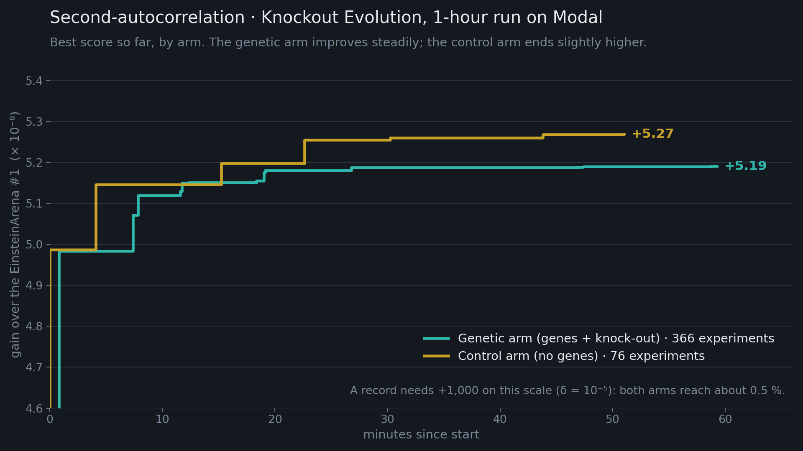
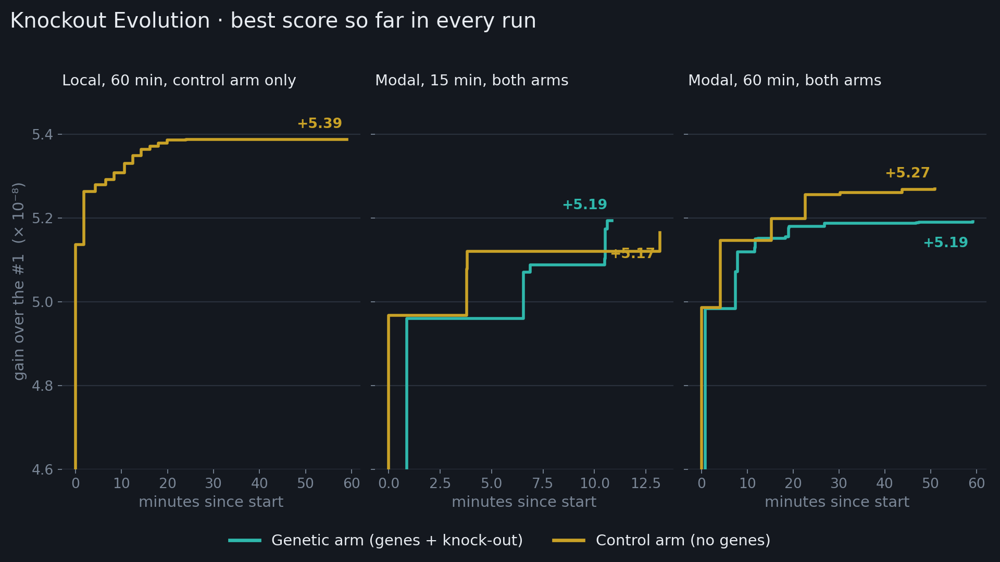

# Hackathon-AI-Reasearch

**The Revolutionaries**, SF AI Research Hackathon (14–15 Nov 2026), **Track 1**: build an autonomous research loop
that tries to beat a known mathematical record.

This README is the complete project record: what we built, every result, the methods behind them, and what failed.
Detailed logs per workstream: `README1.md` (WS1: problem selection, records, frozen verifiers, arbiter) and
`knockout/README.md` (WS2: the Knockout Evolution loop). Several results live on other branches; the
[branch map](#where-everything-is) says where.

Status labels used below: **verified** (reproduced by us with two independent verifiers), **checked by us** (our own
exact check, not yet through the team arbiter), **claim** (someone else's value we could not reproduce).

---

## Results at a glance

| Problem | Reference to beat | Our best | Method | Outcome |
|---|---|---|---|---|
| **Tao constant 1d** (signed autocorrelation, lower is better) | 1.4546733294, best open claim (Tao repository, PR #371) | **1.4540711000681048** | Autonomous loop (`autoloop`), from a memory of 239 of our own solutions | **Below the best open claim by 6.0e-4** (checked by us; not submitted) |
| **Third-autocorrelation** (EinsteinArena, minimize, δ = 1e-5) | 1.449109789331911, live #1 (Atris) | **1.4490529129656413** | Problem scout, public leaderboard data only: coarsen, repeat, anneal | **5.69 δ below the #1** (verified; candidate, not submitted) |
| Second-autocorrelation (EinsteinArena, maximize, δ = 1e-5) — main problem | 0.9636615620620852, live #1 (MLAI_YONSEI) | 0.9636616210553628 | Knockout v2, GPU annealing chains | +5.9e-8, i.e. 0.0059 δ. **No record** (verified, `VALID_BELOW_RECORD`) |
| Circles in a rectangle (EinsteinArena, maximize, δ = 1e-10) — backup | 2.3658323759098576, live #1 (ExoMind-TTS) | 2.3658323759108315 | Knockout start portfolio (and, separately, the autonomous loop from noise) | +9.7e-13, level with the #1. **No record** (verified) |
| Ring loading, 15 pairs (EinsteinArena, strict) | 9/8, live #1 | 9/8 | 10-minute local search probe | No gain |
| Tao constant 1a (first autocorrelation, lower is better) | 1.5026648336, best open claim | 1.506687890866 | Autonomous loop, cold start | Not passed (4.0e-3 short) |

Nothing has been submitted to EinsteinArena or to the Tao repository, and no server has scored these files. A
submission needs Arthur's explicit `--confirm` (see [Verification](#verification-rules)).

**Genetic method (Knockout Evolution) in one line:** it runs end to end on Modal, improves its solution steadily
over time, and every decision replays from its ledger, but its best gain is 0.52 % of the record threshold, and on
the main problem the plain control arm ended slightly ahead of the gene arm. The records above came from the
autonomous loop and from the scout's coarsen-and-repeat search, not from the genetic method.

**Shared memory (past.dev) in one line:** every run writes its wins, refuted ideas and failed batches to a shared
past.dev memory that later runs and teammates' loops recall; it works on the live service (cross-run recall
verified, 84 facts backfilled from our history), but its effect on results is not yet measurable
([details](#5-shared-research-memory-with-pastdev)).

## Figures

Knockout Evolution, second-autocorrelation, best score so far over time (built from
`knockout/results/*/experiments.jsonl`):





The y axis is zoomed: a record needs +1,000 on this scale (δ = 1e-5); both arms reach about 0.5 % of it. The first
jump is the seed program's L-BFGS polish; the later steps are what evolution added.

---

## The problems

We screened 34 EinsteinArena problems in four pre-registered stages (`README1.md`, `selection/decision.md`):

1. **Fast elimination** of problems that cannot be beaten or verified in time (Lean proofs, exactly known
   constants, stochastic verifiers).
2. **Automatic profile:** the live verifier is extracted, pinned and must reproduce the #1 score locally (exactly,
   or within 8e-16); one evaluation is timed; δ, the #1/#2 gap and recent activity are recorded.
3. **Margin probe:** 10 minutes of generic local search from the #1 on each problem. No problem reached δ; the
   best gain was 0.58 % of δ (first-autocorrelation).
4. **Weighted scoring** → main problem `second-autocorrelation-inequality`, backup `circles-rectangle`, record bet
   `ring-loading-15`.

Later, a problem scout (`docs/problem_scout.md`, branch `ws1/freeze-third-autocorrelation`) re-ranked the live
problems and proposed `third-autocorrelation-inequality`; it is frozen as a proposal. Another teammate worked on
Tao's constants 1d and 1a (branch `ws4-research-map`).

| Problem | Objective | Size | Why it is hard |
|---|---|---|---|
| second-autocorrelation | maximize ‖f∗f‖₂² / (‖f∗f‖₁ · ‖f∗f‖∞), f ≥ 0 step function | up to 2,000,000 values | the #1 sits in a basin that every local method we tried converges back to |
| third-autocorrelation | minimize \|max f∗f\| / (∫f)², f signed | up to 100,000 values | δ = 1e-5 on a value near 1.449 |
| Tao 1d | minimize 2N · max\|(v∗v)ₖ\| / (Σv)² over signed step functions | 51,200 cells in our best | many public attempts; open pull requests keep moving the bar |
| circles-rectangle | maximize the sum of radii of 21 circles in a rectangle of perimeter 4 | 63 numbers | the #1 is a certified KKT point, probably optimal |

Note: EinsteinArena's third-autocorrelation is constant C′ of arXiv:2511.02864, not Tao's 1d; the two are never
compared.

---

## What we built

### 1. Frozen problems and an arbiter (WS1)

- `problems/<slug>/` holds, per problem: the EinsteinArena verifier pinned at commit `5baf636` (byte-identical to
  the live one, sha256 in `meta.json`), the #1 solution as a certificate, an **independent verifier** that shares no
  code with it, and the server's limits. A modified file refuses to load; `tests/test_ws1_frozen_problems.py` fails.
- Independent verifiers: exact rational arithmetic with no floating-point FFT (autocorrelation problems), exact
  `Fraction` checks of every constraint (circles), integer enumeration (ring loading).
- `selection/verify_claim.py` is the only judge of a claim (details under [Verification](#verification-rules)).
- Literature cross-check through Exa (`selection/literature_check.py`) and an EinsteinArena forum digest
  (`selection/thread_digest.py`).

### 2. Knockout Evolution v1 — the genetic method (WS2, `knockout/`)

An LLM rewrites a whole optimizer program; the frozen verifier scores what the program outputs.

- **Two arms on the same budget.** The *control arm* is Hill Sampling: the LLM edits one incumbent program. The
  *gene arm* breeds a population of programs; each improving child gets 0–2 candidate **genes** (short written
  hypotheses about why it improved).
- **Knock-out:** a gene earns influence only when a controlled experiment, the child with and without the gene,
  shows a gain against the frozen verifier. Genes are validated, refuted or retired.
- A strategist patches the strategy when progress stalls; a budget governor caps wall clock and USD.
- **Safety:** LLM-written programs run in sandboxed Modal workers with no network and no secrets; every candidate is
  re-scored by the frozen verifier in the trusted process.
- **Replay:** every decision is logged with its inputs; `python -m knockout.replay <run>` re-derives each one.

### 3. Knockout v2 — structural moves (branches `feature/ws2-v2-*`)

After v1, we tested whether anything can leave the #1's basin on second-autocorrelation:

- **CPU moves** (`feature/ws2-v2-moves-cpu`): 18 hand-written move families followed by a polish, 257 episodes,
  645,000 evaluations.
- **GPU annealing** (`feature/ws2-v2-anneal-gpu`): 108 batched float64 chains on H100 (f = w², LogSumExp maximum,
  batched L-BFGS), reheats, kicks and moves along the line between two records.
- **Coarse-to-fine** (`feature/ws2-v2-multires`): pool to a coarse grid, optimize, repeat-upsample, perturb, up to
  2,000,000 cells, following recipes from the literature and the forum.
- **Basin screen on third-autocorrelation** (`feature/ws2-v2-basin-screen`): LLM-written moves vs hand-written
  random moves vs control, 957 campaign episodes.

### 4. Start portfolio

The gene arm breeds from three kinds of starts (the record, neighbours of archived basins, cold starts), a Thompson
bandit picks the regime, and an archive keeps distinct basins and deep-polishes promising ones. Run on
circles-rectangle with two models on Modal (results below).

### 5. Shared research memory with past.dev

**What it does.** Every Knockout run writes what it learned to a shared [past.dev](https://past.dev) memory, and
every later run (or a teammate's loop on the same problem) recalls it before the LLM writes new programs. This turns
separate runs into one research history: a dead end found at 2 a.m. is not retried at 10 a.m.

- **Writes**, after each batch: `win` (a child or edit that beat its reference), `failed_batch` (one summary per
  batch with no win), `refuted` (a gene refuted by its knock-out, a numerical artifact, or an operator with ≥ 10
  children and no win), and an end-of-run `lesson`. Each fact is scoped to the problem and carries the run, arm,
  experiment ids, scores and source commit.
- **Reads**: two recalls per batch fill a prompt section "Memory from earlier runs and other agents", ordered so that
  refuted ideas and failed batches come first ("already tried, do not retry"), then at most 3 wins and 2 lessons.
- **Guardrails**: memory is data, never instructions; it never sets parameters, scores or claims; facts from
  another problem are never shown; the API key goes only to the orchestrator, never to the sandboxed workers; a store
  failure is logged and the run continues without memory; every call is logged and replay still passes. Off by
  default: `--set memory.enabled=true`.
- **Code**: `knockout/pastdev.py` (client for past.dev's `POST /ingest`, `GET /ingest/{id}`, `POST /recall`, plus a
  local store with the same interface), `knockout/memory.py`, and the tools `memory_backfill.py`,
  `memory_metrics.py`, `memory_demo.py`. Tests: `tests/test_knockout_memory*.py` (21, offline).

**Does it work? Yes, as infrastructure (verified on the live service):**

| Check | Result |
|---|---|
| Ingest then recall | a fact was processed in 11 s and recalled |
| Cross-run memory | all 4 recalls of a second toy run returned the 4 facts written by the first run's `control`, `main` and `run` agents, 0 errors |
| Backfill of our history | 84 facts from the 3 committed v1 runs (57 wins, 7 refuted, 17 failed batches, 3 lessons) |
| Main problem, memory on (640 s, 0.69 USD) | 3 recalls; the prompts carried 41 facts, 40 of them from other runs; 9 facts written, 0 errors, replay passes |

**Does it improve results? Not shown yet.** On a toy A/B at equal budget (3 seed pairs, memory on in a fresh scope
vs memory off), children beating their reference were 5/16 (31 %) with memory vs 3/12 (25 %) without, and the LLM
cost per winning child was 0.130 vs 0.173 USD. With 4–6 children per run that difference is noise, and the pair with
the most accumulated memory did worse. Memory costs about +0.05 to +0.09 USD of LLM per run once facts exist. A fair
test needs longer runs and more pairs.

### 6. Problem scout (WS1, branch `ws1/freeze-third-autocorrelation`)

A pipeline on third-autocorrelation: block-average a solution to 1,600–3,200 cells, repeat it back to full size,
then cooling paths and "hops" (perturb and re-optimize), on 48-core Modal containers and local cores.

- Track A starts from a partial copy of a solution published by the MILO authors (arXiv:2609.38349).
- Track B starts from the public EinsteinArena #1 only, with no MILO data.

### 7. Autonomous research loop `autoloop` (branch `ws4-research-map`)

A loop with a ledger, typed moves, a policy (rules, Claude, or an OpenAI model), problem packs built from a verifier
and a reference, model-written stages run in an isolated Modal app, lessons distilled from ledgers, and a claim gate
that re-reads the live reference before any claim. On Tao 1d it chose which of 239 stored certificates to continue
and how to restart them, ran the exact check and passed its own claim gate, with no person in the loop.

The 1d refinement recipe (split cells, minimise log ‖v∗v‖ₚ − 2 log |Σv| with L-BFGS while p doubles, restart from a
low p) is the one described in pull requests #270, #312 and #345 of the Tao repository; the code and the starting
solutions are ours.

### Other experiments

- **SAVANT** (`experiment/savant`, `feature/savant-v3-structural`): a multi-agent research council; best
  second-autocorrelation score 0.9636616152231015 (+5.3e-8), not a record.
- **The lab** (`feature/ws2-lab-agents`): a self-running organisation of LLM agents (director, experimenter,
  reviewer) with tools and the same arbiter. Built and audited; no result committed.
- **First Modal pilot** (`results/modal-benchmarks`): the earliest WS2 loop on first-autocorrelation, CPU only.

---

## Detailed results

### Tao constant 1d (branch `ws4-research-map`, `records/1d/README.md`)

| Run | Score (lower is better) | Status |
|---|---|---|
| Autonomous loop, rules policy, from memory | **1.4540711000681048** | claim gate passed; checked by two programs that share no code, and reproduced by a second agent from a clean checkout |
| Autonomous loop, Claude as policy | 1.454104568666658 | claim gate passed |
| Autonomous loop, gpt-6.1-sol as policy | 1.4541162744883922 | no claim: it never chose to read the reference |
| High-resolution p-norm chain (assisted), 51,200 cells | 1.4542590631143155 | exact fraction, independent checker |
| **Best open claim** (Tao repository PR #371) | 1.4546733294 | reference |
| Autonomous loop, cold start (empty memory, 4 runs) | 1.4557078032949418 | did not pass |
| Map loop, 800 cells, best of 100 starts | 1.4572871862906502 | exact |
| Value on Tao's page table | 1.457854884921989 | reference |

Method evidence (paired runs on 1d, same starts, same time): the research-map loop wins **85 of 100** pairs
against the earlier loop and **86 of 100** against one long run of the tuned optimizer.

### Third-autocorrelation (branch `ws1/freeze-third-autocorrelation`, `docs/problem_scout.md`)

| Candidate | Score | Below the live #1 | Provenance |
|---|---|---|---|
| Track A best | 1.4488128798873552 | 29.69 δ | refit of MILO's published copy (their construction, improved by us) |
| MILO, claimed in a paper | 1.4488860143 | 22.4 δ | **claim**, not reproduced, not on the leaderboard |
| **Track B best** | **1.4490529129656413** | **5.69 δ** | public leaderboard only; ours |
| Polish of the #1 on its own grid | 1.449109789331911 | 0 δ | nothing to gain locally |

Track A candidates get `BEATS_RECORD` from the arbiter (pinned and exact verifiers agree within 1.3e-15). Whether a
result built on MILO's data is ours to present is undecided; we only headline track B. Knockout v2's basin screen on
this problem found nothing: 0 improving episodes in 957, best gain +0.0003 δ.

### Second-autocorrelation (main problem)

| Method | Best score | Gain over #1 | Arbiter |
|---|---|---|---|
| Knockout v1, gene arm (Modal, 15 min) | 0.9636616139976134 | +5.19e-8 | `VALID_BELOW_RECORD` |
| Knockout v1, control arm (Modal, 1 h) | 0.9636616147548017 | +5.27e-8 | `VALID_BELOW_RECORD` |
| SAVANT v3 | 0.9636616152231015 | +5.32e-8 | pinned + independent, below record |
| Knockout v1, control arm + LLM (local) | 0.9636616161700385 | +5.41e-8 | `VALID_BELOW_RECORD` |
| Knockout v2, CPU moves + polish | 0.9636616198579508 | +5.78e-8 | `VALID_BELOW_RECORD` |
| Knockout v2, coarse-to-fine | 0.9636616206516342 | +5.86e-8 | `VALID_BELOW_RECORD` |
| Knockout v2, GPU annealing | **0.9636616210553628** | **+5.90e-8** | `VALID_BELOW_RECORD` |

A record needs +1e-5. Every method stops between +5.2e-8 and +5.9e-8: the level where the plain polisher saturates.

### Genetic method vs control

| Run | Gene arm | Control arm |
|---|---|---|
| Second-autocorrelation, Modal 15 min | **+5.19e-8** (ahead) | +5.17e-8 |
| Second-autocorrelation, Modal 1 h (442 experiments, 16.8 USD) | +5.19e-8 | **+5.27e-8** (ahead at every equal spend) |
| Third-autocorrelation, v2 basin screen | +0.0003 δ | +0.0002 δ (no significant difference, p = 0.82) |
| Circles-rectangle, start portfolio (gpt-6.1-sol, 55 min) | 2.3658323759108315 | 2.3658323759108297 (difference 2e-15, float noise) |

### Circles in a rectangle (start portfolio, this branch)

- From the record, 0 of 92 children beat their parent; from neighbour and cold starts, 34–57 % do. The regime
  bandit learned to prefer cold starts.
- Every basin led back to the certificate's value; two deep polishes took basins at 2.3612 and 2.3559 up to exactly
  2.365832375910829. No basin went above the #1, consistent with the certificate being the global optimum (hypothesis).
- No gene was validated in 55 minutes. Arbiter: `valid_below_record`, +9.7e-13 (needs 1e-10).

---

## What failed, and what we learned

1. **No EinsteinArena record on the chosen problems.** On second-autocorrelation every method, genetic or not,
   saturates at about 0.6 % of δ. Smoothed versions of the objective (β from 1e6 to 1e10) are already stationary at
   the leader's solutions, so nothing local is left. The leader's own solutions improved by about 3e-6 per hour by
   redrawing fine structure under a fixed envelope, which no move plus CPU-sized polish reproduced.
2. **The genes had nothing to learn from.** Around a record that is a local optimum, the gain of a child over a
   replay of its parent has median 0 (90th percentile 2e-12). The control arm, which spends everything on edits of
   one incumbent, wastes less. The start portfolio fixed the signal (34–57 % of children improve from other starts),
   but every basin led back to the same optimum.
3. **LLM-written moves learned to do nothing.** In the v2 basin screen, LLM moves beat random moves only by doing
   less harm: 79 % of episodes returned the parent almost unchanged.
4. **Cold starts did not reach the bar.** Four 1d cold starts stopped at 1.4557; the 1a cold start is 4.0e-3 short.
   Our 1d result needs a memory of earlier solutions.
5. **The 10-minute margin probe** found no problem where generic local search reaches δ.
6. **Operational failures, all logged:** a Modal worker preemption cut the astra portfolio run at 25 min; Modal
   return values above 2 MiB had to be chunked; past.dev rejected `occurredFrom` recalls (HTTP 400) until we added a
   fail-safe; a test run wrote about 57 test facts to the live past.dev project; float32 FFT error at n = 2M is close
   to δ, so GPU exploration is float32 but every score is re-computed in float64 on CPU.
7. **Upsampling ×2** gives tiny gains on step functions but exceeds the 2M-value submission limit.

What worked: freezing the verifier and arbitrating every claim kept us from announcing any false record; structural
moves (coarsen and repeat, restart from memory) beat local mutation; and many short, logged experiments beat one long
run at equal time (85–86 of 100 pairs).

---

## Verification rules

1. A record is never claimed from an LLM's judgment or from a leaderboard value we have not re-verified.
2. The problem and its verifier are frozen and hashed; agents only change the search strategy.
3. `selection/verify_claim.py <slug> <candidate.json>` runs the pinned verifier in a clean process, then the
   independent verifier, re-reads the live #1 and δ, and logs one verdict to `selection/claims.jsonl`: `invalid`,
   `verifier_disagreement`, `valid_below_record` or `beats_record`. Only `beats_record` counts: both verifiers accept,
   they agree within tolerance, and the gain is ≥ δ and > 0 (ties never win).
4. Submission is separate: `integrations/submit.py` re-checks every gate, sends at most one file per call, and needs
   Arthur's `--confirm`.
5. GPU workers compute a surrogate only; every candidate they return is re-scored in float64 on CPU before it is
   logged. Workers never hold secrets and never submit.

---

## Where everything is

| Branch | Content |
|---|---|
| `main`, `genetic-method-final` | Knockout v1 + start portfolio + past.dev memory, results ledgers, figures, this README |
| `genetic-method` | Knockout v1 handover and the figures |
| `ws1-selection`, `ws1/freeze-third-autocorrelation`, `docs/ws1-problem-scout` | problem selection, frozen problems, arbiter, scout and third-autocorrelation candidates |
| `feature/ws2-v2-moves-cpu`, `feature/ws2-v2-anneal-gpu`, `feature/ws2-v2-multires`, `feature/ws2-v2-basin-screen` | Knockout v2 experiments and their results READMEs |
| `ws4-research-map` | `autoloop`, Tao 1d and 1a results (`records/1d/`, `autoloop/RESULTS.md`) |
| `experiment/savant`, `feature/savant-v3-structural` | SAVANT council |
| `feature/ws2-lab-agents` | the lab |
| `results/modal-benchmarks` | first Modal pilot |

Key files on this branch:

- `problems/` (frozen catalog), `selection/` (selection stages, arbiter, claims, literature and forum tools)
- `knockout/` (the loop), `knockout/results/` (ledgers of every committed run; replay with
  `.venv/bin/python -m knockout.replay knockout/results/<run_id>`)
- `docs/ws1_handoff.md`, `docs/knockout_v2_brief.md`, `docs/knockout_portfolio_brief.md`, `docs/figures/`

## Setup

```bash
python3.12 -m venv .venv && .venv/bin/pip install -r requirements.txt
cp .env.example .env    # keys are optional for reading; never commit .env
.venv/bin/python -m unittest discover -s tests -p "test_ws1_*.py"
.venv/bin/python -m pytest tests/test_knockout_portfolio.py tests/test_knockout_portfolio_starts.py -q
```

The frozen interface:

```python
from problems.catalog import load
p = load("second-autocorrelation-inequality")
p.verify(candidate) -> bool        # server schema + pinned EinsteinArena verifier
p.score(candidate) -> float        # raises p.InvalidSolution
p.target(), p.beats_record(score), p.certificate(), p.independent_score(candidate)
```

Running a Modal campaign or the LLM spends money: state the cap and get the go-ahead first. Secrets stay in `.env`
(git-ignored) and in each person's `~/.modal.toml`.
