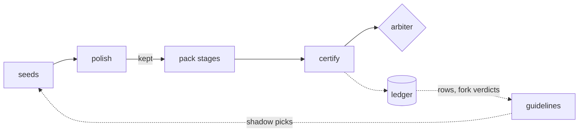

# Architecture v2 proposal: version 8 (Croqui; phase 2, exchange 2)

A relay of verified certificates for any problem given as a verifier, a solution format and a reference. Every move is a bet on the gain of the pool's best certificate, in δ per CPU-second. Policies and guidelines answer every decision in shadow and earn control one decision type at a time. Letters M to W: `<workspace>/shared/arch_v2/04_debate_log.md`. Data: 1d, 1a, 1b.

## Core loop

```python
def round(level, pool, budget, price):
    while budget.left() and (picks := ask(policies, level, pool, ledger, price)):  # TRY, LEAVE
        for b in [picks[controller(level)]] + forks(picks, budget):
            out = b.move(b.item, budget, price)          # round(level-1)
            ok = gate(level, out, b.item)                # BELIEVE
            ledger.append(level, picks, b, out, ok)
            if ok: pool.add(out)
        pool.keep(kept(level, ledger))                   # PASS ON
    return pool.best()
```



## What is recursive

One round at three levels: **3 recipe** (menu and guidelines; an edit; replay, forks), **2 relay** (lineage; new seed, next stage; contract), **1 stage** (certificate; one run; verifier, contract), the base case. Budget and price go down; certificates and realized gains come up (S3, S7, S16).

## What is chained, what is general

Certificate: {problem, spec version, class, sha256, score, parent, displacement, stage, code hash, seed, config, declared work, CPU-seconds, completed}. Stages fetch by (problem, class, sha256), never by file pattern (E7b).

**Stages:** seed→Cert; polish, restart: Cert→Cert; adopt: public file→Cert, value reproduced (E6); certify: Cert→exact Cert. Optional, per pack: refine: Cert[N]→Cert[4N] (E5, E12; S11).

**Declared work:** a stage states its steps and starts only when all of it is reserved under the global caps; `completed` comes from its own step list, so no row is censored and a rerun rebuilds the certificate (D6, L4; S5).

**Boundary:** a stage runs in its own process: allow-listed environment, no network, one scratch directory. The gate recomputes the score and checks hashes, problem, spec version, parent, venue limits, not worse (E7; S13; L6, L8).

**Pack:** the default needs only the verifier, the format and the reference: seeds drawn inside the format or adopted, a generic perturbation polish, L1 distance, direction and δ from the reference (R12). Reach: formats where a random draw is valid, or a public solution. A manifest adds stages and venue limits; a plan outside it is refused (L8).

## How compute is allocated

**bet = mean over matching rows of max(0, best−outcome) × survival ÷ CPU-seconds** (S18's expected improvement per second, on saved rows; R1–R13).

- **Where the bet speaks:** only moves with 5 matching rows, read from the item's own lineage when it has 2 distinct runs (R2; E12). On 1d it is level with a fixed schedule (C2). Elsewhere cold-start order, the edge rule and coverage decide (E3).
- **Probe share:** 10% of a round; half at reach zero (E11, E12; conjecture). Order (R8): edge step (D1), jittered twin (D3), fork, edit. A probe that equals a shadow's logged pick is its fork.
- **Pass on:** by rank where 10 pairs show that rank holds (M2, C3; N4); else by coverage of responders, far apart (E12; S8; R10). A boundary keeps twice the k of every later coverage boundary (S9; N5).
- **Authority:** every policy (present rules, the bet, guidelines, a model) answers every decision. One controls each decision type (width, setting, lineage, stop): at the start, the present rules. The fork share runs a shadow's differing pick from the same state. Winning its forks gives a policy that type (S15, S14).
- **Decision log:** one ledger line per decision: every policy's pick and predicted gain, written before the result, who controlled, reservations, refusals, realized gain. The map page sorts by surprise and lists each claim's ancestry.

## Guidelines the system writes

After each run a model distils the ledger into guidelines (exists). Added (R14): a rule, never the writer, sets every status.

- **Descriptive** guidelines are library predicates: a rate, a correlation, a cost. After every run they are recomputed on all rows of their scope the writer did not see, counted in roots, at no CPU cost (N4). Status follows the number.
- **Pick** guidelines are rules the menu can execute, citing the descriptive ones under them. As shadow policies they are hints (ordering probes), trusted at 15 of 20 forks, dropped with their scope at 5 or fewer of the last 20; back to hint when a fact under them fails or the code behind their rows changes. A trusted one keeps one control run of an option it removes.
- **Scope:** packs whose manifest declares every field read. A lint refuses scores, reference values and file ids (N3).

## Autonomy

A person gives a verifier, a format, a reference, a CPU budget and a USD cap, and says whether adoption is allowed. E12's hand-made decisions and their owners: R16. Runs from a ledger or their problem's guidelines are exploitation (D6).

**A model** writes guidelines and stage files and, like every policy, returns only a legal move. A person applies a rule edit after a held-out replay. It may veto a claim by naming the gate check it doubts, rerun once; it never grants one (S14; D6).

## How truth is established

- **Record:** WS1's arbiter only, where an arbiter pack exists; else the line reads "below the snapshot, own check" (L1).
- **Reference:** every named source must answer; an entry is any open pull request that changes the constant's file; an unparsed entry or a truncated list blocks the claim; snapshot under 30 minutes old, with spec version (E7a; S14; N1).
- **Forks:** the unit is the root seed; ties and invalid outputs go to the incumbent; 15 of 20 wins with a positive mean gain worked, 5 or fewer refuted (E7c; S15; L7).
- **Two systems:** same packs, seeds, ledger, guidelines and budget, policies frozen; two problems, 10 panels each; a win needs 8 panels, the better mean and the better best certificate (E2).

## New compared with the survey

One price orders unlike moves, arrivals included (S9, S16, S18). Rules, guidelines and models earn control at single decisions from one shared state; lessons are predictions the ledger can refute (S15, S7, S4, S3).

## Tests

**Tonight** (R11, R15, R17), 0 USD. T0: a replay gives the worked traces' decisions and refuses the attacks. TA: saved ledgers replayed through every policy; under 10% of decisions differing, a policy gets no control. TG: a planted false guideline is dropped by the rule, not the model.

**Later, prompts listed,** on a problem no rule has seen (circles-rectangle: maximise, a real arbiter). T5a, integration: default pack; pass: verified certificates, a complete log, no person, inside the caps; predicted gain: under δ. T5b, search, equal CPU and seeds: the loop against WS1's flat probe and against the loop plus one model-written stage (under 2 USD); reported: gain/δ of each.

## Exists tonight; what this adds

Exists (`<workspace>/wt-attack/autoloop/`, commit 38e4e76; one flat loop): ledger, typed moves, policies, claim gate, fail-closed reader, tournament, distiller. Build order, owners and clock times: the log, exchange 2. The arbiter pack for 1d is WS1's, named by Arthur; Lupa checks it.
