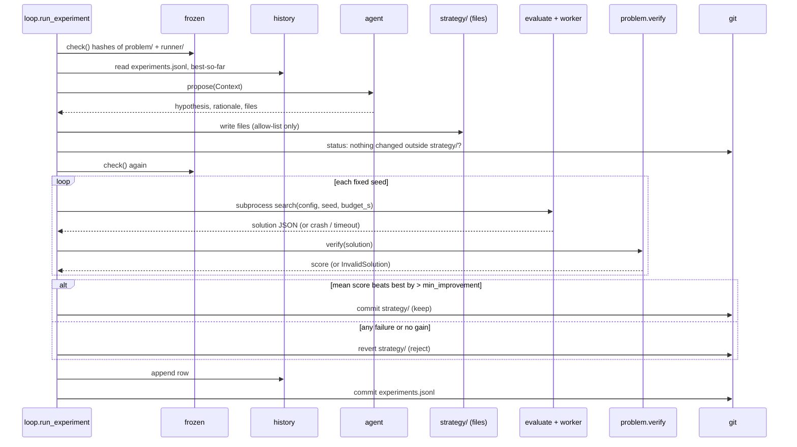

# Architecture

This repository adapts [karpathy/autoresearch](https://github.com/karpathy/autoresearch)
from "an agent improves an LLM training script" to "an agent improves a search
strategy for a verified mathematical record". This document is the reference
that coding agents (Claude Code, Devin, ...) and humans should follow when they
run, extend or refactor the system. It describes components, contracts, the
data flow of one experiment, and the invariants that must never break.

> Status (2026-11-14): the repo holds **two runner implementations** of the
> same architecture: `runner/` (committed) and `autoresearch/` (in progress,
> untracked). Section 8 compares them and lists the decisions needed to merge
> them. Sections 1-7 describe the architecture both of them share.

---

## 1. The research model in one paragraph

A human writes the research brief (`program.md`) and freezes the problem and the
evaluation protocol. An agent then loops: it reads the history of past
experiments, states one falsifiable hypothesis, edits only the strategy code,
and hands it to a fixed, frozen harness. The harness runs the strategy under the
same budget and seeds as every other experiment, scores it with an independent
verifier, and keeps the change only if it beats the best score so far.
Otherwise it reverts the change. Every decision is logged with its reason. Progress is
measured only by the verifier, never by anything the agent or the strategy reports.

## 2. Mapping from karpathy/autoresearch

| autoresearch (Karpathy) | This repo | Kind |
|---|---|---|
| `prepare.py`: read-only constants, data, `evaluate_bpb` (ground truth) | `problem/problem.py`: `verify(solution) -> float`, `DIRECTION`, `KNOWN_BEST` | **Inherited**, made into a pure function |
| `train.py`: the single file the agent edits | `strategy/search.py` + `strategy/config.yaml` | **Inherited**, split into code and knobs |
| `program.md`: human-written agent instructions | `program.md` | **Inherited** as is |
| Fixed 5-minute wall-clock budget | `budget_s` per seed (`runner/config.yaml`) + hard kill at `budget_s + 5` | **Adapted** (per seed, enforced by the harness rather than by trust) |
| Metric `val_bpb`, lower is better | `verify()` score, direction set by `problem.DIRECTION` | **Adapted** (direction is a problem property) |
| One run per experiment | One run **per fixed seed** (default 3), aggregated with the mean | **New**: multi-seed scoring for stochastic search |
| Agent itself runs `uv run train.py` and greps `run.log` | A frozen runner runs the strategy in a subprocess and parses a JSON solution | **New**: the agent never executes or scores its own experiment |
| Keep = advance branch; discard = `git reset` | Keep = commit `strategy/`; reject = checkout/clean `strategy/` | **Inherited** (git as the experiment ledger) |
| Strict `<` comparison | Must beat best by more than `min_improvement` | **Adapted**: a noise threshold |
| `results.tsv` (`commit val_bpb memory_gb status description`), untracked | `experiments.jsonl`, committed, with hypothesis, rationale, per-seed scores, decision, failure reason | **New**: decision log for reproducibility |
| "Do not modify prepare.py" (trust) | `frozen.lock`: sha256 of frozen files, checked before every experiment | **New**: enforced immutability |
| "Only edit train.py" (trust) | Path allow-list + post-edit `git status` scope check | **New**: enforced edit fence |
| The coding agent is the loop ("LOOP FOREVER") | The loop is code; the agent is one pluggable step (`propose`) | **New**: agent interface, offline fallback agent |
| Simplicity criterion (judgement) | Stated in `program.md`; not machine-enforced | Inherited as guidance |

The central architectural shift is this. In Karpathy's design the coding agent *is* the
loop and is trusted to follow `program.md`. Here the loop is **frozen code** and
the agent is reduced to one function, `propose(context) -> proposal`. Everything
the agent could get wrong (editing the evaluator, misreading a score, skipping a
revert, forgetting to log) is moved into code it cannot touch.

## 3. Components and contracts

```
                 human-owned, frozen                       agent-owned
   ┌──────────────────────────────────────────────┐   ┌─────────────────────┐
   │ problem/        runner/ (or autoresearch/)   │   │ strategy/           │
   │  verify()        loop · evaluate · agent      │   │  search.py          │
   │  DIRECTION       frozen · gitops · history    │   │  config.yaml        │
   │  KNOWN_BEST      config.yaml (protocol)       │   └─────────────────────┘
   └──────────────────────────────────────────────┘
   program.md (human brief)   frozen.lock (hashes)   experiments.jsonl (log)
```

### 3.1 Problem (`problem/`): the referee
- **Responsibility:** define what a valid solution is and score it. Nothing else.
- **Contract:** `verify(solution) -> float`. It is pure and deterministic and has no I/O.
  It raises `InvalidSolution` on any constraint violation. It exports `DIRECTION`
  (`"maximize" | "minimize"`), `KNOWN_BEST` (reference only, never used for decisions)
  and problem constants such as `N_POINTS`.
- **Owner:** humans. It is frozen and hash-checked.
- **Swap point:** to target EinsteinArena, a Tao constant or an AlphaEvolve problem,
  replace this module while keeping the same contract.

### 3.2 Strategy (`strategy/`): the player
- **Responsibility:** produce the best solution it can within a time budget.
- **Contract:** `search(config: dict, seed: int, budget_s: float) -> solution`,
  where `config` is `yaml.safe_load(strategy/config.yaml)`. It must be deterministic
  given `seed` and must return within `budget_s`. It must not read or write outside its own directory.
- **Owner:** the agent. This is the **only** writable surface.
- **Why code and config are split:** cheap experiments (knob changes) and
  expensive ones (algorithm changes) go through the same pipeline, and the log
  records which kind each one was.

### 3.3 Protocol (`runner/config.yaml`)
These values are fixed for a whole research run so that scores stay comparable: `seeds`,
`budget_s`, `aggregate`, `min_improvement`, `history_window`, `editable_paths`,
the agent kind and the model. The protocol is frozen. Changing it starts a new,
incomparable series of experiments.

### 3.4 Agent / proposer: the hypothesis step
- **Contract:** `propose(Context) -> Proposal`.
  - `Context` holds the history (last N rows), the best row so far, the current contents of
    the editable files, and `program.md`.
  - `Proposal` holds `hypothesis` (one falsifiable sentence), `rationale_from_history`,
    and `files` (path -> full new content, only for allow-listed paths).
- **Implementations:**
  - `HeuristicAgent`: an offline, deterministic playbook that is history-aware and
    never repeats an idea on the same config. It lets the loop run with no API key
    and in CI.
  - `ClaudeAgent`: sends `program.md`, the history digest and the current strategy to the
    Claude API (`claude-opus-5-5`, server-side refusal fallback enabled) and
    parses one JSON object.
- **The agent never** runs code, sees raw solutions, computes scores, touches git
  or writes the log.

### 3.5 Evaluator (`evaluate.py` + worker): fixed-budget, independent scoring
- For each fixed seed, it starts a **fresh Python process** (`runner._worker`) that imports
  `strategy.search` and prints the solution as JSON. The parent enforces a hard timeout.
- The parent, not the child, calls `problem.verify`. Any score the
  strategy prints is ignored.
- Failure classes: crash, timeout, invalid solution, malformed output. Each one
  turns into a `failure_reason`. A failure is a **result**, not an exception that
  stops the loop.
- Aggregation: the mean over seeds (common random numbers: every experiment
  sees the same seeds, so differences come from the strategy rather than from luck).

### 3.6 Frozen guard (`frozen.py` + `frozen.lock`)
- `frozen.lock` stores a sha256 per file under the frozen directories.
- `check()` runs **before every experiment and again after the agent's edits**.
  On any mismatch it raises `FrozenViolation` and the loop stops.
- Re-locking (`python -m runner.cli freeze`) is a human action, done after a
  deliberate change and committed together with that change.

### 3.7 Ledger (`gitops.py` + `history.py`)
- **Keep:** `git commit strategy/...` with the message `exp-NNNN keep: <hypothesis>`.
- **Reject:** `git checkout HEAD -- strategy/ && git clean -fd strategy/`.
- **Every experiment**, kept or not: one row appended to `experiments.jsonl`
  and committed (`exp-NNNN log: <decision> score=...`).
- As a result, `git log` is the lab notebook, and the best strategy is always `HEAD:strategy/`.

## 4. Data flow of one experiment



If history has no baseline yet, the first call scores the unchanged strategy
and logs it as `decision: baseline`, as Karpathy's "first run is always the
baseline" rule requires.

### experiments.jsonl row (contract between the runner, the agent and the analysis)

| Field | Purpose |
|---|---|
| `id`, `timestamp`, `agent` | identity and provenance |
| `hypothesis`, `rationale_from_history` | **why** the experiment was run (the research reasoning) |
| `idea_key` | dedup key (heuristic agent) |
| `edited_files`, `diff` | **what** changed |
| `seeds`, `budget_s`, `frozen_hash` | **under which protocol** (makes it reproducible) |
| `scores` (per seed), `score`, `best_before` | **what happened** |
| `decision`, `failure_reason` | **what was decided, and why** |
| `duration_s`, `commit` | cost and the exact code that was scored |

The agent reads this log as its memory, so the log format is part of the agent's
interface. Add new fields freely, but never rename or remove existing ones.

## 5. Invariants: what agents must never break

1. **The verifier is the only source of truth.** No decision may depend on a
   number produced by `strategy/` or by the agent.
2. **`problem/` and the runner are immutable during a research run.** Hash-checked
   before and after each proposal. A coding agent must never re-run `freeze` on
   its own initiative to get past a `FrozenViolation`.
3. **The agent writes only `editable_paths`.** This is enforced twice: by the allow-list and by a `git status` diff.
4. **Same protocol for every experiment in a series:** the same seeds, `budget_s`
   and aggregation. Changing them breaks comparability with all history.
5. **One hypothesis per experiment**, stated before the result is known.
6. **Every experiment is logged, including failures.** A missing row equals a lost
   result. Never delete or rewrite rows.
7. **Rejected changes leave no trace in `strategy/`.** After every step the
   working tree is clean.
8. **Strategies run in a separate process with a hard timeout**, so a
   hanging or crashing candidate cannot take down the loop.
9. **Determinism given a seed**: strategies must seed all randomness from `seed`.
10. **`KNOWN_BEST` is a reference, not a target to game.** A score above it is
    first treated as a verifier bug (this already caught a wrong reference
    value once) and only then as a record candidate.

## 6. How a coding agent should extend the system safely

| Change | Where | Rules |
|---|---|---|
| New problem (a real record) | `problem/problem.py`, `program.md`, `strategy/search.py` output format | Keep the `verify` contract; add tests with a known-valid and known-invalid solution; `freeze`; start a fresh `experiments.jsonl` series. |
| New proposer (another LLM, a bandit, ...) | `runner/agent.py`, `make_agent` | Implement `propose(Context) -> Proposal` only. No I/O beyond the model call; on parse/API failure raise or fall back, never return edits outside `editable_paths`. |
| Better evaluation (more seeds, other aggregate) | `runner/config.yaml`, `evaluate.py` | It changes the protocol, so start a new series; `freeze`. |
| More editable files | `editable_paths` | They must stay inside `strategy/`; `freeze`. |
| Parallel experiments | new module | Must preserve invariants 3, 6 and 7: candidates in separate worktrees or directories, with a single writer for the log and for `strategy/`. |
| Reporting / dashboard | read-only consumer of `experiments.jsonl` | Never writes to the log. |

Workflow for any change to a frozen file: make the change on a branch, run
`pytest`, run `python -m runner.cli freeze`, and commit the code together with
`frozen.lock` in **one** commit whose message says why. The tests in `tests/`
pin the invariants: tamper detection, the scope guard, crash → reject → revert,
and the 2-experiment loop. Extend them whenever you add a component.

## 7. Research-loop guidance carried over from program.md

These rules come from Karpathy's `program.md`. They are guidance, not enforced:
- **Simplicity criterion:** at equal score, prefer less code. Deleting code without
  losing score is a win.
- **No new dependencies** in `strategy/`. Use only the standard library and what is in `requirements.txt`.
- **Learn from failures:** read rejected and crashed rows before proposing;
  do not repeat a rejected idea without saying what is different.
- **Do not stop to ask** once a run is started. The runner's `-n` sets the
  length of a session.

## 8. The two runner implementations

`autoresearch/` (untracked, written in parallel) implements the same model with
different storage choices:

| Concern | `runner/` (committed) | `autoresearch/` (in progress) |
|---|---|---|
| Where candidates live | edited in place in `strategy/` | built in `runs/<run_id>/exp_NNNN/strategy/`, copied to `strategy/` only on keep |
| Keep / reject | git commit / git revert | copy into `runs/<id>/best/` (+ `strategy/`); no git |
| Log | `experiments.jsonl` at repo root, committed | `runs/<id>/experiments.jsonl` + Karpathy-style `results.tsv` + `summary.json` |
| Resume | implicit (log + git HEAD) | explicit `state.json`, `--resume <run_id>` |
| Frozen scope | `problem/` **and** `runner/` | `problem/` only |
| `frozen.lock` format | JSON `{path: sha256}` | single line `sha256 <digest>` |
| Heuristic proposer | ordered playbook, skip tried ideas | UCB1 bandit over config moves |
| Code-edit validation | scope check only | `validate_search_py` (compiles, defines `search`, size limit) |
| Claude failure | experiment raises | falls back to the heuristic, records `fallback_reason` |

**They conflict on `frozen.lock`.** Each one overwrites the file in its own format,
so running `python -m autoresearch lock` breaks `runner` and the other way round.
Pick one runner before running both in the same checkout.

Recommended merge if both are kept: take `autoresearch/`'s isolated candidate
directories, `results.tsv`, `validate_search_py` and LLM fallback, and keep
`runner/`'s git ledger (keep = commit) and the hashing of the runner itself,
so the harness is protected as well as the verifier.
